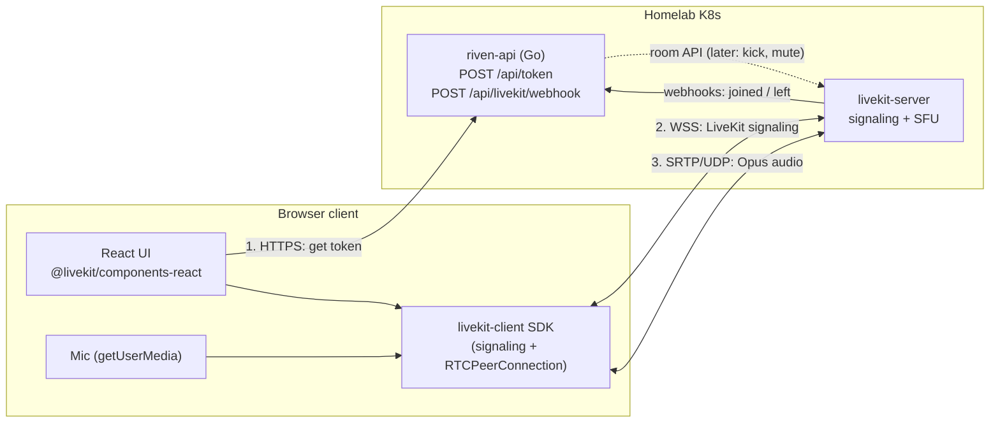
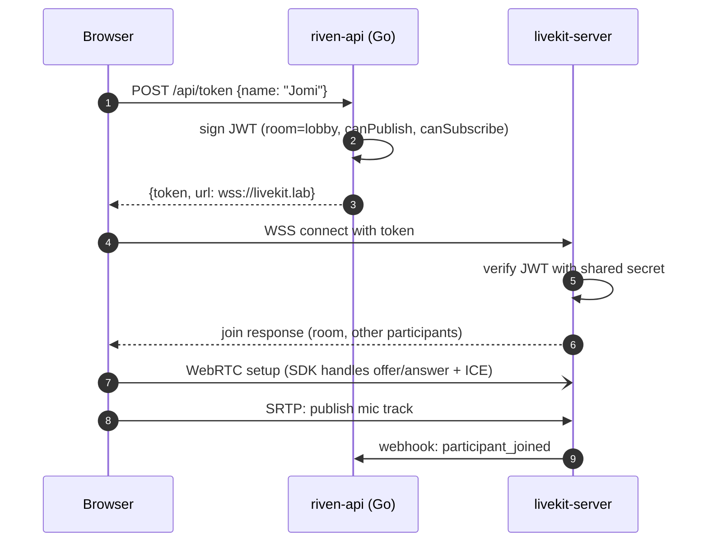
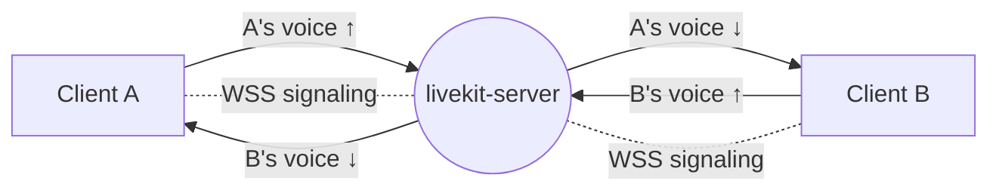
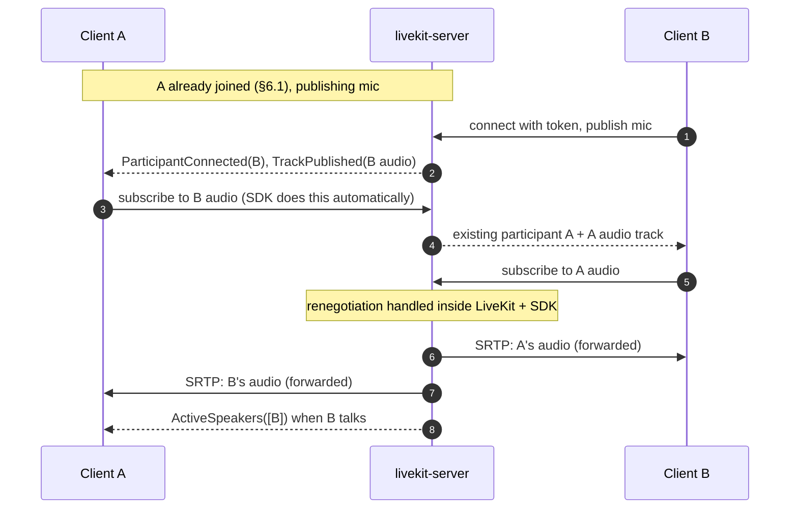
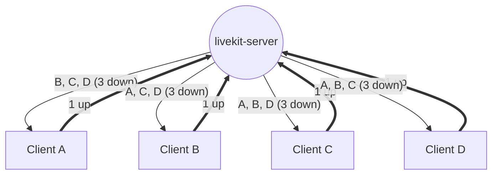
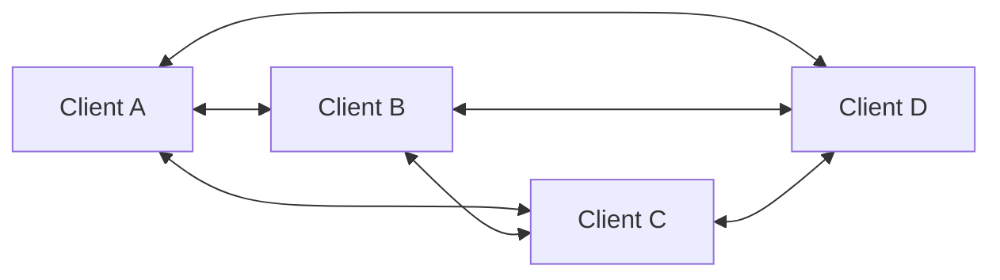
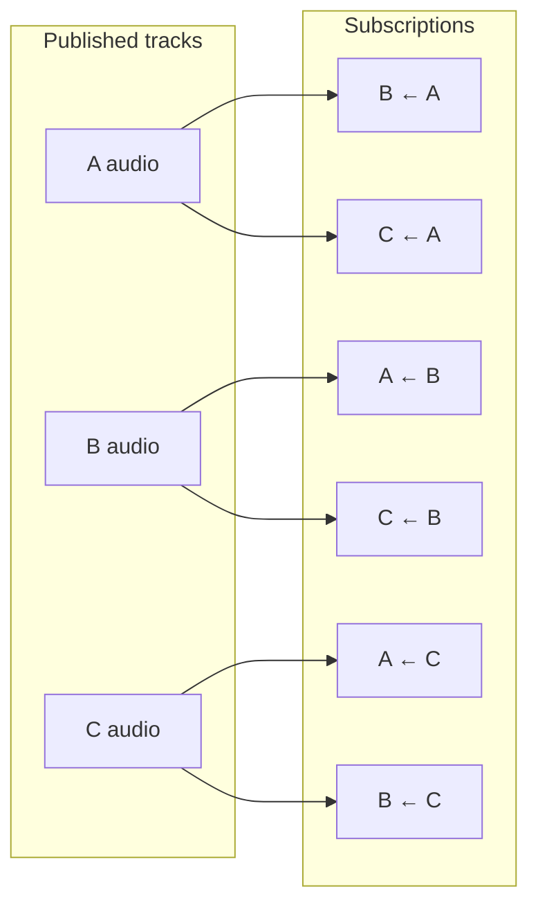
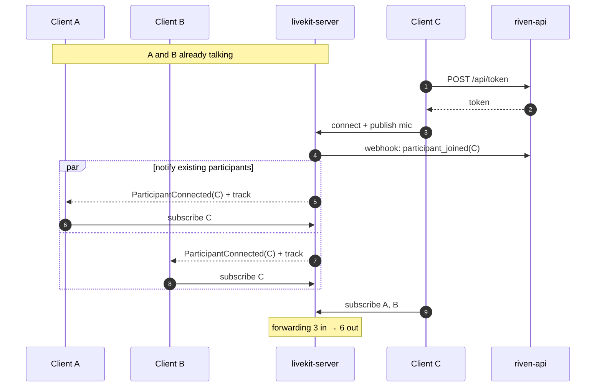
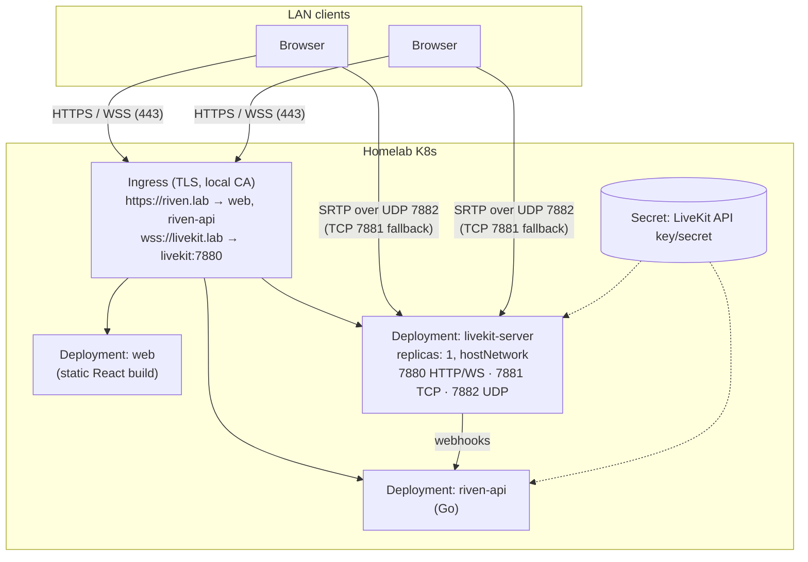

# Riven — Voice MVP Design

Status: **Draft** · Scope: one shared voice session, many clients, homelab K8s as the central server. **LAN only.** No rooms, no auth, no text chat, no off-network access yet.

---

## 1. TL;DR

| Decision | Choice |
|---|---|
| Media transport | **WebRTC** (not raw RTP over WebSocket) |
| Topology | **SFU** (Selective Forwarding Unit) on the homelab |
| SFU | **LiveKit** (open source, Apache 2.0, Go, built on Pion) — *decided 2026-11-07* |
| Our backend | **Go service `riven-api`** — issues LiveKit access tokens, receives webhooks, owns app logic (rooms, users later) |
| First client | **Barebones React page** using LiveKit's React SDK. Terminal client deferred |
| Codec | **Opus**, ~32 kbps per speaker |
| Network reach | **LAN only** for the MVP — no TURN, no port-forwarding, no public IP |

---

## 2. Why WebRTC (not RTP over WebSocket)

- **WebSocket is TCP.** One lost packet stalls everything behind it until it's resent. For voice, a late packet is useless — drop it and move on. That needs UDP.
- **Browsers can't send raw UDP.** WebRTC is the only real-time UDP path a browser has.
- **WebRTC already does the hard audio work:** Opus, jitter buffer, packet-loss concealment, echo cancellation, noise suppression, auto gain, congestion control, SRTP encryption, NAT traversal.

A WebSocket is still used, but only for **signaling** (join/leave, connection setup). With LiveKit, that signaling channel is LiveKit's own protocol and its SDK handles it.

---

## 3. Topology and SFU choice

### Options considered

| | Mesh (P2P) | **SFU** ✅ | MCU (mixer) |
|---|---|---|---|
| Client upload | N−1 streams | 1 stream | 1 stream |
| Client download | N−1 streams | N−1 streams | 1 stream |
| Server CPU | None | Low (copies packets) | High (decode + mix + encode) |
| Practical size | 4–6 people | Dozens+ | Large, at a cost |
| Per-user volume / speaking indicators | Yes | Yes | No |
| Server controls the call | No | Yes | Yes |

SFU is what Discord, LiveKit, Jitsi and mediasoup use.

### Build on Pion vs. LiveKit — decided: LiveKit

| | Build on Pion | **LiveKit** ✅ |
|---|---|---|
| Time to a solid N-person call | Weeks | Hours to days |
| Renegotiation, reconnects, speaker detection, packet-loss recovery | You write them | Built in |
| Rooms, TURN, multi-node scaling | You write them | Config (+ Redis for multi-node) |
| Control | Total | Within LiveKit's model |
| Frontend | Raw WebRTC APIs | SDK + React components |

**Why:** the goal is a Discord-like platform. The media layer is a solved problem, and our effort is better spent on the product: rooms, presence, permissions, text, and running it all on K8s. LiveKit is written in Go, so its source is readable if we need to dig in.

**Trade-offs we accept:**
- Clients speak LiveKit's protocol, so we depend on LiveKit's SDKs.
- Deep changes to how media is forwarded would mean forking.
- Every client needs a signed access token, even on the LAN. That means a token service from day one (small, and we'd want auth later anyway).

---

## 4. Tech stack evaluation

### Go — ✅ good choice, different job
Go's job moves from "media server" to **backend services**:
- `riven-api` uses LiveKit's Go server SDK (`github.com/livekit/server-sdk-go`, plus `github.com/livekit/protocol/auth` for tokens) to mint tokens, call the room API, and verify webhooks.
- Static binaries → tiny images, fast pod startup; strong K8s ecosystem.
- LiveKit is Go too, so debugging means reading Go.
- No signal processing on our side. Echo and noise cleanup happen in the browser, and LiveKit only forwards packets.

### React frontend — ✅ good choice
- Use `livekit-client` + `@livekit/components-react`. These give join/leave, mic publish, remote audio playback, participant list, mute and speaking indicators almost for free.
- The MVP page: a name field, a "Join" button, a participant list with speaking/muted state, a mute button.
- ⚠️ **Mic access needs HTTPS (or `localhost`).** The page must be served over HTTPS and LiveKit over `wss://`. Otherwise the browser blocks it as mixed content.

### Terminal client — ⚠️ deferred
It needs native audio libraries, Opus and its own echo handling. For testing, use LiveKit's CLI (`lk`) instead: it can join bots and run load tests (`lk load-test`), with no custom code.

### Infra
- **livekit-server** — official Docker image / Helm chart; pin an exact version.
- **TLS on the LAN** — cert-manager with a local CA, or `mkcert`. Browsers must trust the CA.
- **Redis** — not needed for a single LiveKit node. Add it when scaling to multiple nodes.
- **STUN / TURN** — not needed while LAN only. LiveKit has a built-in TURN server for phase 5.

---

## 5. Components

- **riven-api** — our Go service. For the MVP it does two things:
  1. `POST /api/token { name }` → returns a LiveKit JWT for room `lobby` with publish + subscribe rights. Identity is a random ID; the display name is the typed-in name.
  2. Receives LiveKit webhooks (`participant_joined`, `participant_left`, `room_finished`) and logs them. This is where presence and history will plug in later.
- **livekit-server** — handles signaling, the WebRTC connections, track fan-out, renegotiation, speaker detection.
- **Browser** — gets a token, connects to LiveKit, publishes its mic, plays everyone else's audio.

Shared secret: LiveKit's API key and secret live in a K8s Secret, mounted into both `livekit-server` and `riven-api`.

---

## 6. Call flows

### 6.1 Joining (token flow)

### 6.2 Two clients in a call

Each client talks only to LiveKit, never directly to the other client:

> Note: LiveKit opens two WebRTC connections per client by default — one to publish, one to subscribe. The diagrams show them as one link.

### 6.3 More than two clients (4 shown)

Every client uploads 1 stream and downloads N−1:

For comparison, the same call as a mesh (6 connections, each client uploads 3 copies):

Inside the SFU, each incoming track fans out to N−1 subscribers:

### 6.4 A third client joins

LiveKit does the renegotiation; our code only sees events.

When someone leaves, LiveKit sends `ParticipantDisconnected` to the others and `participant_left` to `riven-api`.

---

## 7. Homelab / Kubernetes deployment (LAN)

Notes (check exact config keys against the LiveKit version we pin):

1. **Media ports.** LiveKit can run all WebRTC traffic over one UDP port (`rtc.udp_port: 7882`) plus a TCP fallback (`rtc.tcp_port: 7881`). Much easier on K8s than a port range.
2. **Reachable IP.** On the LAN, turn off external IP discovery (`rtc.use_external_ip: false`) and make sure LiveKit advertises the **node's LAN IP**, not the pod IP. LiveKit recommends **`hostNetwork: true`**, which gives this for free. Pin the pod to one node (nodeSelector) so the IP is stable.
3. **Alternative to hostNetwork:** MetalLB `LoadBalancer` Service for UDP 7882 + TCP 7881, with LiveKit's node IP set to the LoadBalancer IP.
4. **One replica, no Redis.** A single LiveKit node handles hundreds of voice participants. Multi-node needs Redis and is a later phase.
5. **Ingress:** allow WebSocket upgrade on the LiveKit host; raise idle timeouts.
6. **TLS:** cert-manager with a local CA (or `mkcert`). Install the CA on every client device, phones included, or the browser will block the mic.
7. **Webhooks:** LiveKit calls `riven-api` over the cluster Service DNS (`http://riven-api.riven.svc:8080/api/livekit/webhook`); `riven-api` verifies the signature with the shared secret.
8. **Deploy method:** official LiveKit Helm chart, or plain manifests. Plain manifests are simpler to understand for one node.

---

## 8. Phased plan

| Phase | Goal | Done when |
|---|---|---|
| 0 | **LiveKit locally** — `livekit-server --dev`, test with the `lk` CLI or LiveKit's sample app | Two browser tabs on one machine hear each other |
| 1 | **riven-api token service + barebones React page**, running locally | Our own page joins `lobby`; two tabs hear each other |
| 2 | **N clients**: participant list, mute, speaking indicators, webhook logging | 4+ clients; join/leave shows up in the UI and in `riven-api` logs |
| 3 | **Deploy on homelab K8s** (LAN, TLS, hostNetwork LiveKit) | Phase 2 works from phones and laptops on the LAN |
| 4 | **Load test** with `lk load-test` | Know CPU/bandwidth at 10/25/50 participants |
| 5 | **Off-LAN access** — LiveKit TURN, port-forwarding, real auth | A friend outside the network can join |
| 6 | **Rooms**, presence, permissions; Redis + multi-node if needed | Multiple independent voice channels |

Bandwidth estimate (Opus ~32 kbps + overhead ≈ 40–50 kbps per stream). On a LAN this is a non-issue; it matters again in phase 5, when your home upload becomes the limit.

| Participants | Server in | Server out | Per client down |
|---|---|---|---|
| 2 | 2 streams ≈ 0.1 Mbps | 2 ≈ 0.1 Mbps | 1 stream |
| 5 | 5 ≈ 0.25 Mbps | 20 ≈ 1 Mbps | 4 streams |
| 10 | 10 ≈ 0.5 Mbps | 90 ≈ 4.5 Mbps | 9 streams |
| 25 | 25 ≈ 1.25 Mbps | 600 ≈ 30 Mbps | 24 streams |

---

## 9. Decisions log

| Date | Decision |
|---|---|
| 2026-11-06 | WebRTC + SFU topology |
| 2026-11-06 | LAN only for the MVP; TURN and port-forwarding wait until phase 5. TLS still needed on the LAN for mic access |
| 2026-11-07 | Use LiveKit as the SFU instead of building one on Pion. Our Go backend becomes `riven-api` (tokens, webhooks, app logic) |

## 10. Open questions

1. **What does your cluster have?** MetalLB? Which Ingress? cert-manager? Can a pod use `hostNetwork` on a known node?
2. **Identity:** is a typed-in display name enough for now? (Recommended: yes.)
3. **Repo layout:** monorepo (`/api`, `/web`, `/deploy`) is the suggested default.
4. **Deploy tooling:** Helm chart vs. plain manifests vs. Kustomize for LiveKit and our services.
5. **Domain names on the LAN:** e.g. `riven.lab` and `livekit.lab`, served by your router's DNS or Pi-hole?
